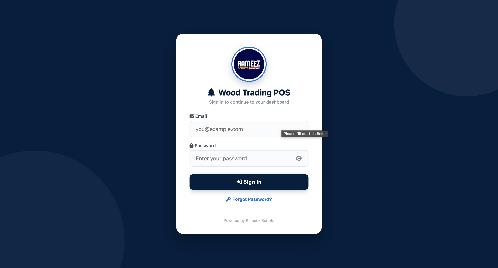
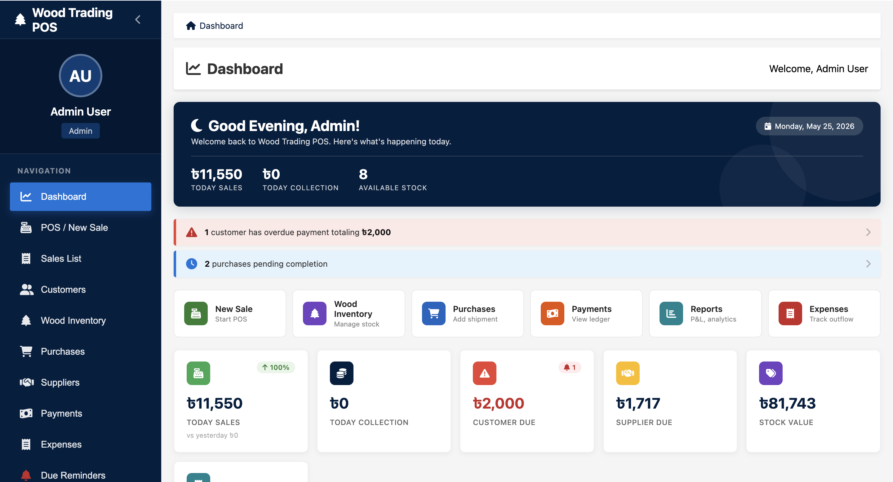

# Wood Trading POS — Demo (Google Sheets + Apps Script)

A lightweight Point-of-Sale demo built with Google Sheets + Google Apps Script. Use freely for testing and small businesses.

Demo Login Info
- Email: `admin@demo.com`
- Password: `admin123`

Files
- Main script: `code.gs`
- Screenshots: `Login.png`, `Demo.png`

Key Features
- Sales, Purchases, Stock, Customers, Suppliers, Payments, Expenses
- Reporting, Dashboard stats, Import logs, Activity logs
- Role-based access (admin, manager, cashier, warehouse_staff)
- Seed demo data via setup function

Quick setup (macOS / Google Sheets)
1. Open Google Sheets → Extensions → Apps Script.
2. Create new project and replace the script with `code.gs` from this folder.
3. Save, then run the function `setupDemoData()` once to create sheets and seed demo data. Grant permissions when prompted.
4. Return to the spreadsheet. Open the "Users" sheet to verify demo users.
5. Login using the demo credentials in your app/UI (or check the Users sheet).

Notes
- This is an Apps Script project; the UI integration (sidebar/web app) is separate — the script provides backend data operations.
- Place `Login.png` and `Demo.png` alongside this README so they render correctly on previews.

Screenshots

License
- Free to use for personal and commercial testing.